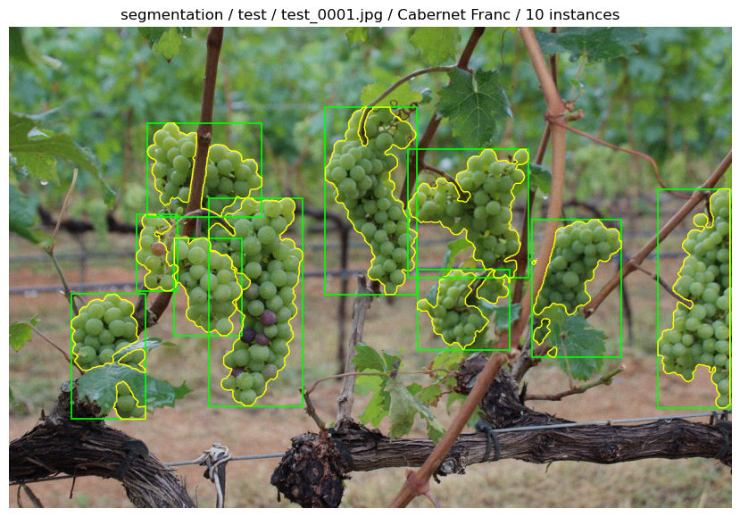

# ViSC-Bench

**A Corruption-Robust Grape Instance Segmentation Benchmark for Human-vs-LLM Evaluation**

ViSC-Bench evaluates instance-segmentation predictions for grape instances in images affected by corruption. Participants submit individual instance masks, class labels, and confidence scores. Submissions are evaluated automatically against private test annotations using COCO instance-segmentation evaluation.

<p align="center">
  
</p>

## Public data

The public dataset is organized as follows:

```text
data/public/
├── images/
│   ├── train/
│   ├── val/
│   └── test/
└── annotations/
    ├── instances_train.json
    ├── instances_val.json
    └── images_test.json
```

- `images/train/`: training images.
- `images/val/`: validation images.
- `images/test/`: test images used to generate predictions.
- `instances_train.json`: COCO-format training annotations, including instance masks.
- `instances_val.json`: COCO-format validation annotations, including instance masks.
- `images_test.json`: test-image metadata and category definitions.

**The test annotations are hidden.** `images_test.json` intentionally contains image metadata and categories but has an empty `annotations` array. Use its image IDs and category IDs when creating your submission. Do not add or infer ground-truth annotations.

## Task: instance segmentation

Submit one prediction record for each detected grape instance. Each record must contain:

| Field | Description |
|---|---|
| `image_id` | Integer image ID from `images_test.json`. |
| `category_id` | Integer category ID from the `categories` section of `images_test.json`. |
| `segmentation` | COCO polygon segmentation: a list containing one or more flat polygon coordinate arrays. |
| `score` | Confidence score between `0` and `1`. |

A polygon array is a sequence of pixel coordinates in this order:

`[x1, y1, x2, y2, x3, y3, ...]`

Each polygon must have at least three coordinate pairs (at least six numbers), with an even number of finite numeric coordinates. Coordinates must refer to the provided test image at its published resolution. The outer `segmentation` list is required, even when an instance has only one polygon.

**This is an instance-segmentation task, not a bounding-box detection task.** Do not submit a detection-only record containing `bbox` instead of `segmentation`. A `bbox` field is not required for the segmentation submission format.

## Submission format

Upload a `.json` file containing a JSON array of COCO instance-segmentation prediction records. For example:

```json
[
  {
    "image_id": 127,
    "category_id": 2,
    "segmentation": [
      [
        569.6, 233.74,
        568.0, 235.34,
        564.8, 236.94,
        547.2, 252.95,
        532.8, 276.96,
        516.8, 302.58
      ]
    ],
    "score": 0.93
  }
]
```

The example demonstrates the required structure. Replace the example coordinates, image ID, category ID, and score with values generated for your predictions. The image and category IDs must exist in the public test metadata.

### Submission requirements

1. The file must be valid JSON and its top-level value must be an array. An empty array is valid JSON, but an empty submission may be rejected.
2. Every prediction must include `image_id`, `category_id`, `segmentation`, and `score`.
3. Use only image IDs and category IDs listed in `images_test.json`.
4. `segmentation` must be a non-empty list of polygon arrays. Each polygon must contain at least three `(x, y)` coordinate pairs.
5. Polygon coordinates must be finite pixel values within the corresponding image boundaries. Do not submit normalized coordinates or YOLO text labels.
6. `score` must be a finite number in the range `[0, 1]`.
7. Submit one record per predicted instance. Multiple instances in the same image should have separate records.
8. Submit predictions only. Do not include ground-truth annotations, image files, training labels, or explanatory text in the JSON file.
9. An image with no predicted instances does not need a prediction record.

The public example uses COCO polygon masks. Do not assume that binary mask arrays, YOLO segmentation text files, or arbitrary RLE encodings are accepted unless the repository's current `submission_format.json`, validator, and evaluator explicitly document and support them.

See `data/public/annotations/submission_format.json` and `sample_submission.json` if they are provided in the repository; use the repository files as the final authority for the accepted schema.

## How to submit

Submit your prediction JSON file through the official Google Form:

[Open the ViSC-Bench submission form](https://docs.google.com/forms/d/e/1FAIpQLSfpWIkww8p7WCDKGLa_RiBqJhdI0vPptJh-KXscpXZ7jq4sAg/viewform)

Complete the form's required team and model information and upload or provide the prediction file as requested. Please do not submit private ground-truth data or share private organizer links.

## Evaluation and leaderboard

Submissions are checked for format and valid IDs, then evaluated against the private test annotations using COCO instance-segmentation evaluation (`segm`). The leaderboard reports segmentation metrics such as AP, AP50, and AP75. A successful format validation does not guarantee a high segmentation score; the score measures agreement between predicted instance masks and the hidden annotations.

[View the ViSC-Bench leaderboard](https://faranbutt.github.io/ViSC-Bench/)

## Reproducibility and fair use

- Use the publicly released training and validation data for model development.
- Use the published test images and metadata to prepare predictions.
- Do not attempt to obtain, reconstruct, publish, or otherwise use hidden test annotations.
- Report the model and inference settings accurately in the submission form.
- Do not include Google Drive file IDs, private download URLs, credentials, or organizer-only materials in public issues, pull requests, or leaderboard metadata.

## Questions and troubleshooting

Before submitting, verify that your JSON parses, every ID exists in `images_test.json`, every instance has a polygon mask, all polygon coordinates use pixel units, and every confidence score is between `0` and `1`.